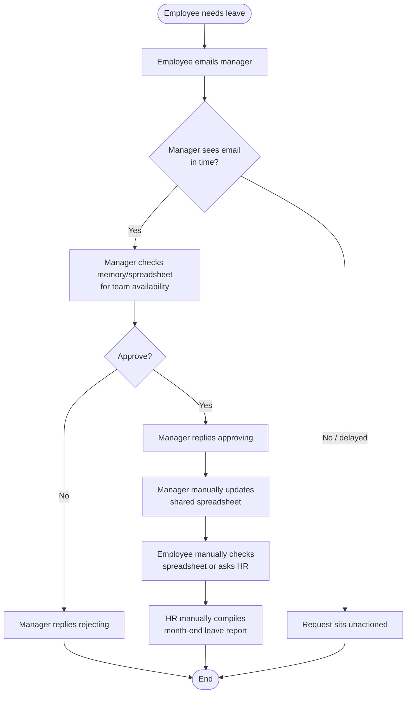
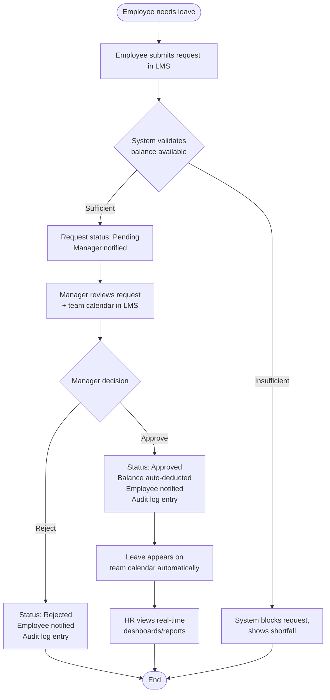

# Process Analysis: AS-IS vs TO-BE
## Employee Leave & Approval Management System

### AS-IS Process (Manual, Email/Spreadsheet-Based)

**Pain points identified:**
1. No system enforces that a request even reaches the manager (email can be missed).
2. No automatic balance check — over-allocation of leave is possible.
3. Spreadsheet updates are manual and error-prone (double entry, no validation).
4. No audit trail — disputes about "who approved what, when" are common.
5. HR reporting requires manually opening and cross-referencing spreadsheets.

---

### TO-BE Process (System-Based)

**Improvements delivered:**
1. Every request is captured in the system — nothing gets lost in inboxes.
2. Balance validation happens automatically before submission.
3. Managers get calendar visibility, reducing coverage clashes.
4. Every action is logged automatically — full audit trail.
5. HR reporting is real-time, no manual compilation.

### Process Comparison Summary

| Aspect | AS-IS | TO-BE |
|---|---|---|
| Request channel | Email | Self-service system |
| Balance check | Manual/none | Automatic |
| Approval turnaround | ~3 days | < 24 hours (target) |
| Team visibility | None | Real-time calendar |
| Audit trail | None | Full, immutable log |
| Reporting | Manual spreadsheet compilation | Real-time dashboard |
